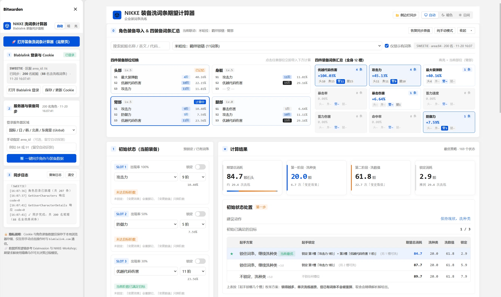

# NIKKE 装备洗词条期望计算器（浏览器扩展）

《胜利女神：妮姬》（NIKKE）T10 企业装词条洗练概率与期望计算器，提供 **Firefox** 与 **Microsoft Edge** 浏览器扩展版本，以及独立单文件网页版。

## 核心功能

- **完整策略与模拟工具**：输出最优起手锁定方案对比、分步行动指南、数值洗练阶段表、手动策略对比、数值总表及模拟洗练测试器。
- **Blablalink 角色装备同步**：通过浏览器内已登录的 `blablalink.com` Cookie 本地读取并同步账号妮姬与 T10 词条数据，支持繁简角色名转换，数据仅保存于本地浏览器存储。
- **四装备词条汇总与联动**：直观展示头、身、臂、腿四部位词条与全身 12 槽词条汇总，点击任意部位一键带入计算，并自动记忆各部位锁定与目标条件。

## 界面预览

- **左侧：同步面板（侧边栏 / 弹窗）**：Blablalink 登录与 Cookie、服务器区域选择、一键同步、同步日志。
- **顶部「角色装备导入 & 四装备词条汇总」**：搜索并选择妮姬；左侧为头 / 身 / 臂 / 腿四部位的 3 槽词条与阶数，点击即带入计算；右侧为全身 12 槽词条汇总（条数、累计百分比与各部位阶数）。
- **左下「初始状态」与目标条件**：当前装备 3 槽位词条、阶数与锁定开关。
- **右下「计算结果」**：期望总消耗、两阶段消耗、锁定消耗，以及初始状态处置与起手方案对比表。

---

## 安装方式

前往本仓库 [Releases](https://github.com/Hoomarck/NIKKE_calc_addon/releases) 页面下载对应浏览器安装包：

### Firefox（通过 `.xpi` 安装）

1. 在 Releases 下载已签名的 `nikke-calc-firefox-ext-signed.xpi`。
2. 将 `.xpi` 文件直接拖入 Firefox 窗口，或在 `about:addons` → 齿轮图标 →「**从文件安装附加组件...**」中选择该文件，按提示确认安装。
3. （仅调试）也可在 `about:debugging#/runtime/this-firefox` 点击「**临时载入附加组件...**」，选择 `nikke-calc-firefox-ext/manifest.json`。

> [!IMPORTANT]
> **首次使用需手动授权站点访问权限**
> 为读取你的角色与词条数据，扩展需要访问 `blablalink.com` 的网站数据（Cookie 与接口）。首次使用时请留意：
> - 安装时的弹窗中点击「**添加 / 允许**」；
> - 若同步面板提示缺少权限，点击面板内「**授予权限**」，并在弹出的浏览器对话框中允许；
> - 也可在 `about:addons` → 本扩展 →「**权限**」选项卡中，手动开启「访问 blablalink.com 的数据」。
>
> 未授权时将无法读取角色 / 词条信息；如需完全不授权，请使用「纯手动模式」。

### Microsoft Edge（解压 `.zip` 后通过开发者模式加载）

1. 在 Releases 下载 `nikke-calc-edge-ext.zip` 并**解压**到本地目录（确保该目录内直接包含 `manifest.json`）。
2. 在 Edge 地址栏打开 `edge://extensions`。
3. 开启页面左下角（或底部）的「**开发人员模式**」开关。
4. 点击「**加载解压缩的扩展**」，选择解压后的文件夹即可完成安装。

---

## 使用指南

### 1. 登录并同步角色装备（可选）

1. 点击浏览器工具栏中的扩展图标打开同步面板（可点击面板右上角「**📌 侧边栏**」在侧边栏常驻打开）。
2. 若提示缺少权限，点击「授予权限」以允许访问 `blablalink.com`（⚠️ 首次使用必须授权，详见上方安装说明中的权限提示，否则无法读取角色 / 词条信息）。
3. 点击「**打开 Blablalink 登录**」，在官方页面完成账号登录。
4. 回到同步面板点击「**保存 / 更新 Cookie**」，确认服务器区域（Global / HMT；一般留空 `area_id` 自动探测即可）。
5. 点击「**🔄 一键同步角色与装备数据**」，等待同步完成。

### 2. 导入部位与计算最优洗练方案

1. 点击面板顶部的「**🚀 打开装备洗词条计算器（完整页）**」。
2. 在页面顶部「**0. 角色装备导入 & 四装备词条汇总**」中搜索并选择目标妮姬，查看全身 12 槽词条汇总，点击「头部 / 身躯 / 臂部 / 腿部」任意部位即可带入下方计算器。
3. 在左栏确认「**1. 初始状态**」（可手动调整预锁定槽位），并在「**2. 快速预设 & 目标条件**」选择预设或自定义目标词条与阶数（支持“三选一”等 OR 条件）。
4. 右栏将实时计算并展示「**计算结果**」「**初始状态处置与起手方案对比**」以及「**策略详情**」（分步行动指南、数值洗练阶段、手动策略对比、数值总表、模拟洗练测试器）。
5. 若无需同步账号，可点击顶部「**纯手动模式**」直接录入词条进行计算。

---

## 仓库结构

- `nikke-calc-firefox-ext/` — Firefox (Manifest V3) 扩展源码、测试与打包脚本
- `nikke-calc-edge-ext/` — Microsoft Edge / Chromium (Manifest V3) 扩展源码、测试与打包脚本（迁移细节见 [nikke-calc-edge-ext/README.md](nikke-calc-edge-ext/README.md)）
- `NIKKE-装备洗词条期望计算器.html` — 独立单文件网页版计算器（同时作为扩展计算引擎一致性的测试基准）
- `implementation_plan.md` — 架构与功能设计说明
- `LICENSE` — 仓库许可协议
