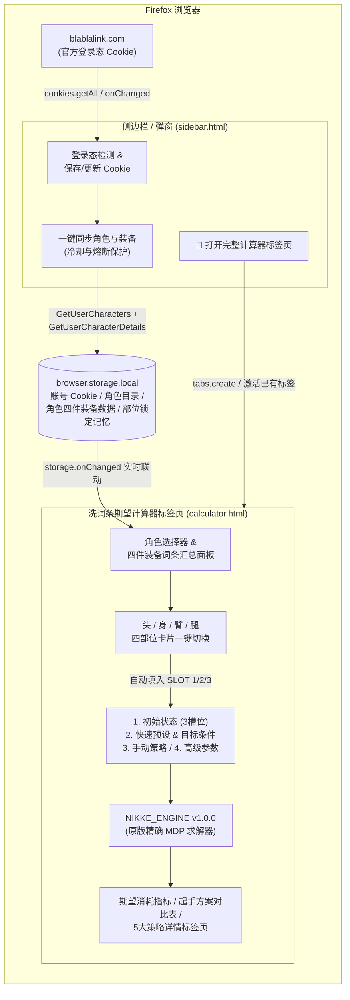

# NIKKE 装备洗词条期望计算器（Firefox 独立纯净版扩展）设计方案

根据您的确认，本项目采用 **方案 A（独立纯净版 Firefox MV3 扩展）**，仅保留核心 **Blablalink Cookie 抓取**，通过 **侧边栏 (`sidebar_action`) / 弹窗 (`popup`)** 完成登录同步与一键展开完整计算器标签页，并在计算器中提供 **角色四件装备词条汇总** 与 **四部位一键切换导入**，计算逻辑与预期方案展示 100% 遵循本地 [NIKKE-装备洗词条期望计算器.html](file:///C:/Users/54210/Documents/NIKKElines/NIKKE-装备洗词条期望计算器.html)。

---

## 一、 整体架构与目录结构

扩展将于工作区内独立目录 `C:\Users\54210\Documents\NIKKElines\nikke-calc-firefox-ext` 下构建，采用**纯原生 ES Module + HTML/CSS** 架构，零第三方打包冗余依赖，可直接在 Firefox 中载入调试或打包为 `.xpi` / `.zip`。

### 目录文件规划

| 文件路径 | 职责说明 |
| :--- | :--- |
| `manifest.json` | Firefox MV3 清单：配置 `gecko` 标识、`sidebar_action`、`action` (popup)、`cookies` / `storage` / `tabs` / `declarativeNetRequest` 权限及 `*://*.blablalink.com/*` 主机权限。 |
| `background.js` | 后台脚本：管理 DNR 动态 Cookie 注入规则，处理打开/聚焦完整计算器标签页消息。 |
| `theme.js` | 提取自 [NIKKE-装备洗词条期望计算器.html](file:///C:/Users/54210/Documents/NIKKElines/NIKKE-装备洗词条期望计算器.html#L790-L900) 的 `ThemeCtl`（支持自动 / 暗色 / 日间主题无闪烁同步，侧边栏与计算器共享同一主题偏好）。 |
| `engine.js` | 提取自 [NIKKE-装备洗词条期望计算器.html](file:///C:/Users/54210/Documents/NIKKElines/NIKKE-装备洗词条期望计算器.html#L1064-L3006) 的 `NIKKE_ENGINE` v1.0.0 精确 MDP 求解与模拟引擎（**代码与数学模型零改动**）。 |
| `blablalink-api.js` | 参考 `ExiaInvasion` 与 [NIKKE-Workshop/src/services/api.js](file:///C:/Users/54210/Documents/NIKKElines/NIKKE-Workshop/src/services/api.js) 提炼的核心抓取模块：Cookie 提取、`area_id` 自动探测与 `1300015` 恢复链路、角色繁简名称解析、角色四件装备词条抓取与标准化转换。 |
| `sidebar.html` / `sidebar.css` / `sidebar.js` | 侧边栏与弹窗共用的控制面板：权限检查、登录引导、保存/更新 Cookie、服务器与手动 `area_id` 设置、同步装备数据、运行日志及「打开洗词条计算器」按钮。 |
| `calculator.html` / `calculator.css` / `calculator.js` | 洗词条计算器主界面：完整保留原版 HTML 的布局、TDesign 样式与全部计算功能，在左栏顶部集成「角色选择 + 四件装备词条汇总 + 四部位切换导入」模块。 |
| `icons/` | 扩展图标（16 / 32 / 48 / 128 px）。 |

---

## 二、 核心模块详细设计

### 1. 侧边栏 (`sidebar_action`) 与弹窗 (`popup`) 登录同步面板
- **双入口统一体验**：
  - 点击 Firefox 工具栏图标可弹出面板，也可通过 Firefox 侧边栏常驻打开 `sidebar.html`。
  - 顶部常驻醒目的主按钮 **「🚀 打开装备洗词条计算器（完整页）」**（若计算器标签页已打开则直接激活并聚焦该标签页，避免重复打开多个相同标签页）。
- **站点访问权限检测**：
  - 自动检查 Firefox 是否已开启 `*://*.blablalink.com/*` 访问权限；若未开启，顶部展示警告条与一键「授予权限」按钮。
- **Blablalink Cookie 登录与同步流程**：
  1. **状态识别**：实时检测浏览器中 `blablalink.com` 下的 `game_token`、`game_uid`、`game_openid`。
  2. **去登录**：未检测到登录态时，点击「打开 Blablalink 登录」新建标签页跳转 `https://www.blablalink.com/login`，并通过 `cookies.onChanged` 自动感知登录完成。
  3. **保存/更新 Cookie**：提取当前浏览器 Cookie 并自动请求 `GetUserGamePlayerInfo` / `GetUserProfileBasicInfo` 解析玩家昵称与 `area_id`。
  4. **服务器与手动 `area_id`**：提供服务器选择（`国际/日/韩/北美/东南亚 Global` vs `港澳台 HMT`）与可选的手动 `area_id` 输入框（默认留空自动识别）。
  5. **一键同步角色装备数据**：
     - 拉取并缓存角色名目录（自动转换为简体中文名，包含特殊译名覆盖如 `5143 -> 渡鸦`）。
     - 调用 `GetUserCharacters` 获取已拥有角色列表。
     - 调用 `GetUserCharacterDetails` 批量获取已拥有角色的四件装备词条 (`character_details` + `state_effects`)。
     - 内置请求保护：成功后 60 秒冷却、失败后 10 秒重试冷却，实时输出同步进度日志。

---

### 2. 数据转换与四件装备词条汇总计算

#### (1) 接口词条 $\rightarrow$ 计算器槽位映射
对于每位角色的 4 个装备部位（`0: 头部 Head`、`1: 身躯 Torso`、`2: 臂部 Arm`、`3: 腿部 Leg`），读取 `${slot}_equip_option1..3_id` 并在 `state_effects` 中查找：

| Blablalink `function_type` | 计算器 `type` ID | 计算器显示名称 | 简称 (`abbr`) | 1~15 阶数值范围 (%) |
| :--- | :--- | :--- | :---: | :--- |
| `IncElementDmg` | `elite` | 优越代码伤害 | 优 | `9.54% ~ 29.16%` |
| `StatAccuracyCircle` | `hit` | 命中率 | 命 | `4.77% ~ 14.63%` |
| `StatAmmoLoad` | `ammo` | 最大装弹数 | 弹 | `27.84% ~ 85.37%` |
| `StatAtk` | `atk` | 攻击力 | 攻 | `4.77% ~ 14.63%` |
| `StatChargeDamage` | `chg` | 蓄力伤害 | 蓄 | `4.77% ~ 14.63%` |
| `StatChargeTime` | `spd` | 蓄力速度 | 速 | `1.98% ~ 6.09%` |
| `StatCriticalDamage` | `cdmg` | 暴击伤害 | 伤 | `6.64% ~ 20.36%` |
| `StatCritical` | `crit` | 暴击率 | 率 | `2.30% ~ 7.07%` |
| `StatDef` | `def` | 防御力 | 防 | `4.77% ~ 14.63%` |

- **槽位位置 (`position`)**：严格对应 `SLOT 1`、`SLOT 2`、`SLOT 3`（若某槽位无词条则为 `{ type: null, tier: 1, locked: false }`）。
- **阶数 (`tier`)**：优先使用接口返回的 `func.level` (`1~15`)；若异常缺失则根据 `Math.abs(func.function_value) / 100` 与 `TYPE_DEFS.values` 最近邻匹配阶数。

#### (2) 角色四件装备词条汇总算法（辅助决策当前部位目标）
选中角色后，遍历该角色 **头 / 身 / 臂 / 腿** 共 4 件装备的 12 个槽位，按计算器 `state.cfg.types` 的阶数数值表（以整数基点 `Math.round(val * 100)` 累加避免浮点误差）计算 9 种词条的汇总数据：
- **每项词条统计**：
  - `count`：4 件装备上共出现几条（`0 ~ 4 条`）
  - `totalVal`：4 件装备合计百分比（如 `4 条 · +47.24%`）
  - `tiers`：各部位分布阶数明细（如 `头12 / 身11 / 臂10 / 腿—`，悬停或小字可直接看到哪个部位缺该词条或阶数最低）
- **交互联动提示**：
  - 在四装备词条汇总区中，当前正在洗练的装备部位所贡献的词条会带有高亮标记，方便玩家直观看出：「如果把当前这件装备洗成攻+优+弹，全身凑齐几攻几优几弹」。

---

### 3. 计算器页面新增 UI 设计（融入原版 TDesign 布局）

在 [NIKKE-装备洗词条期望计算器.html](file:///C:/Users/54210/Documents/NIKKElines/NIKKE-装备洗词条期望计算器.html#L937-L1018) 左栏（或横跨顶部的导入卡片）新增 **「0. 角色装备导入 & 四装备词条汇总」** 卡片：

1. **角色选择栏**：
   - 搜索过滤输入框（支持角色名模糊搜索） + 角色选择下拉框（显示已同步且拥有词条数据的妮姬，或全部已拥有妮姬）。
   - 右侧状态徽标：显示同步时间、角色总数，以及「打开同步面板 / 刷新数据」与「切回纯手动模式」快捷按钮。
2. **四件装备词条汇总（全身 12 槽总览）**：
   - 采用 3×3 紧凑网格展示 9 类词条的 `词条名称`、`条数徽标 (如 4条)`、`合计百分比 (如 +95.44%)` 以及四部位阶数简写（如 `12/11/13/—`）。
   - 已有词条（`count > 0`）按品牌蓝/高亮色展示，0 条词条以次要灰底展示。
3. **四部位装备切换卡片（头部 / 身躯 / 臂部 / 腿部）**：
   - 4 张水平或 2×2 排列的部位卡片，每张卡片展示：
     - 部位名称（`头部` / `身躯` / `臂部` / `腿部`）与当前激活状态高亮边框。
     - 3 行槽位预览：`S1 攻击力 12阶 (12.51%)`、`S2 优越代码 11阶 (23.56%)`、`S3 — 空 —`（阶数徽标复用原版 `tier-1` ~ `tier-top` 样式）。
   - **一键带入**：点击任意部位卡片，立即将该部位的 3 个槽位同步到下方 `1. 初始状态（当前装备）`，并自动触发 `recalc(true)` 计算最优洗词条方案。
4. **部位锁定与目标记忆**：
   - 玩家在某角色某部位下手动切换的「锁定开关 (`locked`)」或调整的「目标条件 (`reqs`)」会自动按 `角色 + 部位` 记忆在本地存储中；同时提供「恢复同步初始状态」按钮。

---

## 三、 验证与交付计划

1. **计算一致性校验**：
   - 编写自动化测试脚本（Node 测试），验证拆分后的 `engine.js` 与原 [NIKKE-装备洗词条期望计算器.html](file:///C:/Users/54210/Documents/NIKKElines/NIKKE-装备洗词条期望计算器.html) 在所有预设、初始锁定组合、阶段一与阶段二下的计算输出（期望总石头、阶段一/二石头、锁定石头、起手方案表、分步行动指南）**100% 逐位一致**。
2. **数据抓取与映射测试**：
   - 测试 Blablalink `GetUserCharacters` + `GetUserCharacterDetails` + `state_effects` 响应解析、四部位 1/2/3 槽位映射及四装备词条汇总（条数 + 总百分比 + 部位分布）的准确性。
3. **Firefox 扩展规范与打包校验**：
   - 校验 `manifest.json` 的 Firefox MV3 兼容性（无内联脚本 CSP 报错、`sidebar_action` 与 `popup` 正常工作），并在工作区生成可直接安装的解压版目录及打包好的 `.zip` / `.xpi` 文件。
