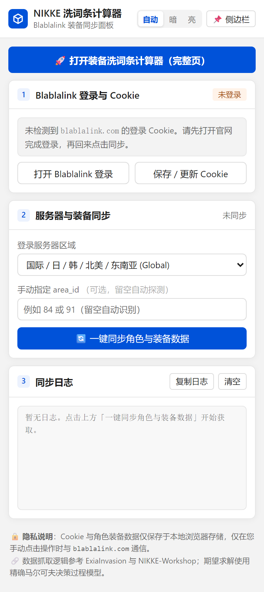
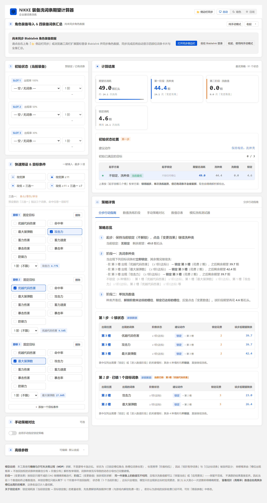

# NIKKE 装备洗词条期望计算器 · Microsoft Edge 扩展版

由 Firefox 版 `nikke-calc-firefox-ext` 迁移而来的 Chromium / Microsoft Edge（Manifest V3）版本。
**计算引擎、MDP 求解逻辑、页面结构与 UI 样式完全沿用原项目**，仅替换浏览器适配层。

- 计算引擎 `engine.js` 与原版逐字节一致（`tests/engine-parity.test.mjs` 用 SHA-256 + 全场景求解结果双重校验）
- 样式表 `calculator.css` / `sidebar.css` 仅改动一行注释，视觉零变化
- 扩展 API 全部改经 `extension-api.js` 垫片调用，Edge 下不再出现 `ReferenceError: browser is not defined`

| 工具栏弹窗（380px） | 计算器完整页 |
| --- | --- |
|  |  |

> 以上截图由 `scripts/smoke-edge.mjs` 同款方式在无头 Edge 157 中真实渲染抓取。

---

## 一、在 Edge 中加载未打包扩展进行测试

1. 打开 `edge://extensions`
2. 打开左下角（或页面底部）的 **开发人员模式 / Developer mode** 开关
3. 点击 **加载解压缩的扩展 / Load unpacked**
4. 选择本目录：`C:\Users\54210\Documents\NIKKElines\nikke-calc-edge-ext`
   （⚠️ 选择包含 `manifest.json` 的这一层，不要选择上级目录）
5. 扩展卡片出现后即可使用：
   - 点击工具栏的扩展图标 → 打开 380px 弹窗面板（登录状态 / 一键同步 / 日志）
   - 固定图标到工具栏：点击「扩展」拼图图标 → 将「NIKKE 洗词条」固定
   - 弹窗内点击 **📌 侧边栏** → 在 Edge 侧边栏常驻打开同一面板（Chromium `sidePanel`）
   - 点击 **🚀 打开装备洗词条计算器（完整页）** → 打开完整计算器标签页

### 首次使用流程

1. 弹窗/侧边栏内点击 **打开 Blablalink 登录**，在官网完成登录（`https://www.blablalink.com/login`）
2. 回到面板点击 **保存 / 更新 Cookie**（会自动解析角色名与 `area_id`）
3. 选择服务器区域（Global / HMT），必要时手动填 `area_id`
4. 点击 **🔄 一键同步角色与装备数据**，完成后进入计算器完整页即可看到四件装备词条汇总

### 排错

| 现象 | 处理 |
| --- | --- |
| 加载时报 `manifest.json` 相关错误 | 确认选择的是 `nikke-calc-edge-ext` 目录本身，且未被压缩成 zip 直接解压到多层子目录 |
| 同步提示「未授予访问权限」 | `edge://extensions` → 本扩展「详细信息」→ 确认站点访问权限为「在特定网站上」且包含 `blablalink.com` |
| 侧边栏按钮无效 | Edge 需 114+；更低版本会自动降级为在新标签页打开同一面板 |
| 提示未登录 | 先在同一浏览器的 `blablalink.com` 完成登录，Cookie 是按浏览器配置隔离的 |

---

## 二、相对 Firefox 版的变更清单

### 新增文件

| 文件 | 说明 |
| --- | --- |
| `extension-api.js` | 跨浏览器兼容垫片：解析扩展命名空间（Edge 用 `chrome.*`，Firefox 用 `browser.*`），把 Chromium 回调式 API 统一 Promise 化；提供 `sendMessageSafe`、`openSidePanel`、`detectPopupContext` 等封装 |
| `tests/edge-manifest-csp.test.mjs` | 替代原 `tests/firefox-manifest-csp.test.mjs`：校验 Edge/Chromium MV3 清单、图标、CSP、无 `browser.*` 残留、模块导入可达、打包内容 |
| `scripts/smoke-edge.mjs` | 真机冒烟测试：用无头 Edge 装入扩展，经 DevTools Protocol 校验 SW 启动、API 可用性、DNR 读写、三个页面无异常、storage/cookies/permissions 端到端往返 |
| `README.md` | 本文档 |

### 修改文件

| 文件 | 变更 |
| --- | --- |
| `manifest.json` | 重写为 Chromium MV3：删除 `browser_specific_settings`；`background.scripts` → `background.service_worker` + `type: "module"`；`sidebar_action` → `side_panel`；新增 `sidePanel` 权限；新增 `minimum_chrome_version: "116"`；版本号 1.0.0 → 1.1.0 |
| `background.js` | 改为 MV3 Service Worker（ES Module）；所有 `ext.*` 调用改经 `callApi()` Promise 化；消息监听改为可选链安全注册；导出接口与消息类型保持不变 |
| `sidebar.js` | 删除 `globalThis.browser ?? globalThis.chrome`；改用垫片；`sidebarAction.open()` → `chrome.sidePanel.open()`（含标签页降级）；`sendMessage` 改用 `sendMessageSafe`；新增弹窗上下文兜底识别（清单查询串失效时仍按 380px 渲染） |
| `calculator.js` | 删除自解析命名空间；`openSyncSidebarSync()` 改为 `chrome.sidePanel.open()` + `tabs.create` 降级；`tabs.create` 改经 `callApi` |
| `blablalink-api.js` | 删除自解析命名空间；`storageGet/storageSet`、`cookies.getAll`、`permissions.contains/request`、`tabs.create`、`runtime.sendMessage` 全部经垫片；对外导出名称保持不变 |
| `sidebar.html` | 两处 Firefox 文案改为 Edge（侧边栏按钮 title、权限提示语）；结构/类名/样式未动 |
| `calculator.css` | 仅注释里的「Firefox 扩展增强模块」→「Edge 扩展增强模块」 |
| `scripts/package-ext.mjs` | 运行时清单加入 `extension-api.js`；产物由 `.zip` + `.xpi` 改为单个 `dist/nikke-calc-edge-ext.zip` |
| `tests/blablalink-mapping.test.mjs` | 模拟 `runtime.getURL` 前缀 `moz-extension://` → `chrome-extension://` |
| `tests/firefox-manifest-csp.test.mjs` | 已删除（由 `tests/edge-manifest-csp.test.mjs` 取代） |

### 未改动文件

`engine.js`、`t2s.js`、`theme.js`、`calculator.html`、`calculator.js` 的计算逻辑（仅适配层）、`calculator.css`（注释除外）、`sidebar.css`、`icons/*`、`tests/engine-parity.test.mjs`。

---

## 三、Manifest V3 适配要点

| 项目 | Firefox 版 | Edge / Chromium 版 |
| --- | --- | --- |
| 浏览器标识 | `browser_specific_settings.gecko`（id / strict_min_version / data_collection_permissions） | 已移除（Chromium 不识别，属 Firefox 专属） |
| 后台脚本 | `background.scripts: ["background.js"]` | `background.service_worker: "background.js"` + `type: "module"` |
| 侧边栏 | `sidebar_action.default_panel` | `side_panel.default_path: "sidebar.html"` + `permissions: ["sidePanel"]` |
| 工具栏入口 | `action.default_popup: "sidebar.html?mode=popup"` | 同上（已验证 Chromium 接受带查询串的弹窗入口） |
| 权限 | `cookies` / `storage` / `tabs` / `declarativeNetRequest` / `declarativeNetRequestWithHostAccess` | 保留并新增 `sidePanel`；全部为 Chromium 认可的权限字符串 |
| 主机权限 | `*://*.blablalink.com/*` | 同上（MV3 下安装即授予，无需运行时请求） |
| CSP | `script-src 'self'; object-src 'self';` | 同上（未放开 `unsafe-inline`/`unsafe-eval`，页面无内联脚本与 `on*` 属性） |
| 图标 | `icons` + `action.default_icon` 四档 PNG | 同上，尺寸 16/32/48/128 已逐张校验 |

> `side_panel.default_path` 使用**不带查询串**的 `sidebar.html`：Chromium 对 `default_path` 只接受包内相对路径，
> 因此侧边栏上下文通过「无查询串 = sidebar 模式」判定，弹窗上下文由 `?mode=popup` 显式声明；
> 万一查询串丢失，`detectPopupContext()` 会用 `chrome.runtime.getContexts()` 二次识别。

## 四、API 命名空间兼容策略

原代码已有一行 `globalThis.browser ?? globalThis.chrome`，但存在两个隐患：
`browser` 在 Edge 中确实不存在（旧写法靠 `??` 侥幸可用，但各处散落、易漏），且 Chromium 的异步 API **以回调为主**，
`await chrome.storage.local.get(...)` 在很多版本上会拿到 `undefined`。本版统一收敛到 `extension-api.js`：

```js
import { callApi, ext, sendMessageSafe, openSidePanel } from "./extension-api.js";

// ext 优先取 chrome（Edge/Chrome），其次 browser（Firefox）
const data = await callApi(ext.storage.local, "get", ["key"]);   // 自动补回调 + 读 lastError
const rule = await callApi(dnr, "updateDynamicRules", payload);  // 回调式 / Promise 式均可用
const res  = await sendMessageSafe({ type: "OPEN_CALCULATOR_TAB" });
```

判定规则：被调用方法的**声明参数个数 > 实参个数** ⇒ 视为回调式 API（补上回调并检查 `runtime.lastError`），
否则按 Promise 式调用。两条路径都返回 Promise，业务代码一律 `await`。
此外 `sidePanel.open()` 必须严格在用户手势内**同步**调用，因此 `openSidePanel()` 内部不含任何 `await`。

---

## 五、自动化验证

```powershell
# 单元测试 + 清单/打包校验（14 项，含引擎逐字节与求解结果对齐）
node --test tests/*.test.mjs

# 生成可分发压缩包 -> dist/nikke-calc-edge-ext.zip
node scripts/package-ext.mjs

# 真机冒烟（需要本机安装 Edge 138+；用 DevTools Protocol 装载扩展）
node scripts/smoke-edge.mjs
```

`smoke-edge.mjs` 在 Edge 157.0.4341.60 上的实测结果：

- manifest 被正常解析，MV3 Service Worker 以 ES Module 启动
- `chrome.sidePanel.open`、`storage`、`cookies`、`tabs`、`action`、`declarativeNetRequest` 均可用
- DNR `modifyHeaders`（注入 `Cookie`）规则写入/清理成功
- 弹窗页按 380px `popup` 模式、侧边栏页按 100% `sidebar` 模式渲染，计算器页引擎与预设按钮正常生成，**三页均无 JS 异常**
- 端到端：`storage` 往返、`cookies.getAll`、`permissions.contains`、页面 → Service Worker 的 DNR 注册/注销、打开计算器标签页全部通过

---

## 六、已知限制

- 侧边栏需要 Edge 114+；`sidePanel.open()` 需要 Edge 116+（`minimum_chrome_version: "116"`）
- Chromium 新版本（含本机 Edge 157）已支持通过 `Extensions.loadUnpacked` 装载扩展；`--load-extension` 命令行开关在品牌版 Edge/Chrome 中可能被忽略，脚本因此默认走 CDP 装载
- 同步依赖 `blablalink.com` 的登录 Cookie 与官网接口稳定性，与 Firefox 版行为一致
- 商店上架需自行准备 `dist/nikke-calc-edge-ext.zip` 与隐私说明（扩展不上传任何数据，仅在本地与 `blablalink.com` 通信）

## 许可

GPL-3.0-or-later（与 Firefox 版一致）。
